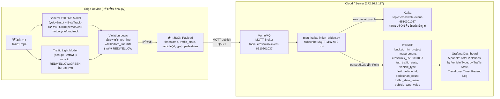
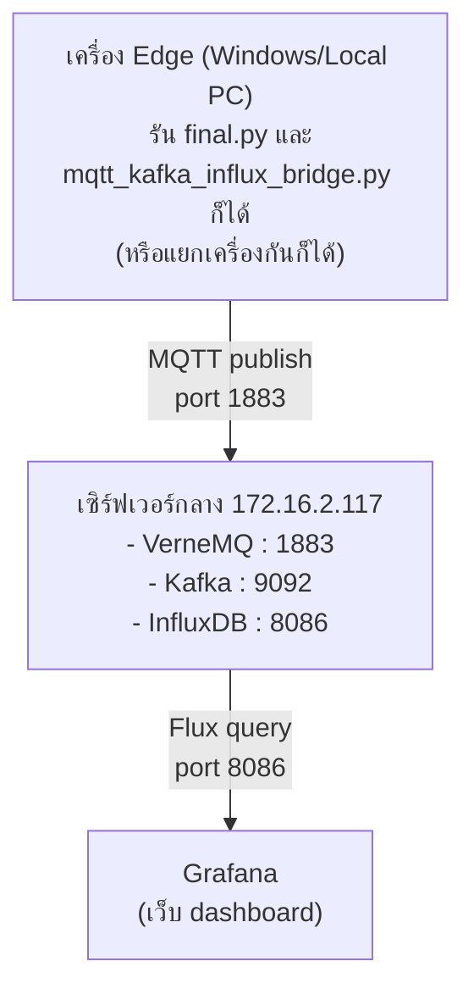

# System Architecture Diagram

**Edge-to-Cloud Real-Time Smart Traffic Analytics Platform**
โครงการตรวจจับการฝ่าไฟแดง/ไฟเหลืองบนทางม้าลาย ด้วย YOLOv8 สองโมเดล ส่งข้อมูลจาก Edge
ขึ้น Cloud แบบ real-time ผ่าน MQTT → Kafka / InfluxDB → Grafana

## แผนภาพการไหลของข้อมูล (Data Flow)

## คำอธิบายแต่ละขั้นตอน

| # | ขั้นตอน | รายละเอียด |
|---|---------|-----------|
| 1 | **อ่านวิดีโอ** | `final.py` เปิดไฟล์ `data/Train1.mp4` ทีละเฟรมด้วย OpenCV เมื่อจบคลิปจะวนกลับไปเฟรมแรกอัตโนมัติ (loop) |
| 2 | **ตรวจจับคน/รถ** | โมเดล YOLOv8 ทั่วไป (`yolov8m.pt`, COCO) + ByteTrack (`custom_tracker.yaml`) ตรวจจับและติดตาม ID ต่อเนื่องของ person/car/motorcycle/bus/truck |
| 3 | **ตรวจจับไฟจราจร** | โมเดลที่เทรนเอง (`runs/detect/traffic_light-2/weights/best.pt`) ตรวจจับกล่องไฟจราจรทั้งกล่อง แล้วให้สีตรงๆ จาก class (0=RED, 1=YELLOW, 2=GREEN) กรองด้วย ROI กันจับผิดจุด |
| 4 | **ตรวจการฝ่าไฟ** | เช็คว่าจุดล่างกึ่งกลางของกล่องรถ (bottom-center) ข้ามทั้ง `top_line` และ `bottom_line` ของ `crosswalk_zone` ระหว่างที่ไฟเป็น RED หรือ YELLOW หรือไม่ (จำกัดขอบเขตด้วย x-range กันรถเลนอื่นถูกนับผิด) |
| 5 | **สร้าง Payload** | เมื่อยืนยันว่าฝ่าไฟจริง (นับ 1 ครั้งต่อ track ID) สร้าง JSON payload ทันที |
| 6 | **ส่งเข้า MQTT** | Publish payload (JSON string) ไปที่ VerneMQ broker หัวข้อ `crosswalk-event-6510301037` ด้วย QoS 1 |
| 7 | **Bridge กระจายข้อมูล** | `mqtt_kafka_influx_bridge.py` subscribe topic เดียวกัน แล้วแตก 2 ทางพร้อมกัน: (ก) ส่งต่อ bytes ดิบเข้า Kafka topic เดิมทันที ไม่แปลงอะไรเลย (ข) แกะ JSON แล้วเขียนเป็น data point เข้า InfluxDB |
| 8 | **แสดงผลใน Grafana** | Grafana ต่อกับ InfluxDB โดยตรง ใช้ Flux query ดึงข้อมูลมาแสดงเป็น 5 panels (สรุปยอดรวม, แยกตามประเภทรถ, แยกตามสถานะไฟ, แนวโน้มตามเวลา, log ล่าสุด) |

## Physical / Network View

