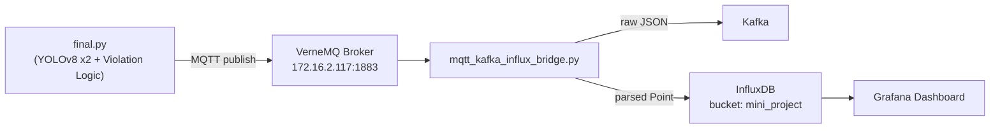

# Edge-to-Cloud Real-Time Smart Traffic Analytics Platform

ระบบตรวจจับ **การฝ่าไฟแดง/ไฟเหลืองบนทางม้าลาย** จากวิดีโอกล้องวงจรปิด ด้วย YOLOv8 สองโมเดล
(ตรวจคน/รถ + ตรวจสีไฟจราจรที่เทรนเอง) แล้วส่งเหตุการณ์ที่ตรวจพบขึ้น Cloud แบบ real-time ผ่าน
MQTT → Kafka / InfluxDB → Grafana dashboard

ดูแผนภาพการไหลของข้อมูลแบบละเอียดได้ที่ [`ARCHITECTURE.md`](./ARCHITECTURE.md)

## ภาพรวมสถาปัตยกรรม



## โครงสร้างไฟล์ในโปรเจกต์

```
.
├── final.py                        # สคริปต์หลัก: ตรวจจับ + ติดตาม + ตรวจฝ่าไฟ + ส่ง MQTT
├── mqtt_kafka_influx_bridge.py      # bridge: MQTT -> Kafka (raw) + MQTT -> InfluxDB (parsed)
├── custom_tracker.yaml              # ค่า config ของ ByteTrack (ปรับ track_buffer ให้ทนกล้องสั่น/บัง)
├── requirements.txt                 # รายการ Python package ที่ต้องติดตั้ง
├── Dockerfile.detector              # image สำหรับรัน final.py
├── Dockerfile.bridge                # image สำหรับรัน mqtt_kafka_influx_bridge.py
├── docker-compose.yml               # orchestrate ทั้งสอง service ข้างบนพร้อมกัน
├── .env.example                     # แม่แบบตัวแปร/secret ที่ docker-compose ต้องใช้
├── .gitignore                       # กันไฟล์ที่ไม่ควรขึ้น git (ดูหัวข้อ "ขึ้น Git อะไรบ้าง")
├── data/
│   └── Train1.mp4                   # วิดีโอต้นฉบับที่ใช้ตรวจจับ (และใช้เทรนโมเดลไฟจราจร)
├── runs/detect/traffic_light-2/weights/
│   └── best.pt                      # โมเดล YOLOv8 ที่เทรนเองสำหรับตรวจสีไฟจราจร (red/yellow/green)
├── ARCHITECTURE.md                  # System Architecture Diagram (Mermaid)
└── README.md                        # ไฟล์นี้
```

> **หมายเหตุ**: `yolov8m.pt` (โมเดลทั่วไปสำหรับ person/car/motorcycle/bus/truck) ไม่ต้องเตรียมเอง
> — `ultralytics` จะดาวน์โหลดให้อัตโนมัติตอนรันครั้งแรกถ้ายังไม่มีไฟล์อยู่ในเครื่อง

## Prerequisites

- Python 3.10+ (โปรเจกต์นี้พัฒนาและทดสอบบน Python 3.11)
- เข้าถึงอินเทอร์เน็ตได้ตอนรันครั้งแรก (เพื่อดาวน์โหลด `yolov8m.pt`)
- เชื่อมต่อเครือข่ายไปยังเซิร์ฟเวอร์กลาง `172.16.2.117` ได้ (VerneMQ / Kafka / InfluxDB รันอยู่ที่นั่น
  ให้บริการอยู่แล้ว ไม่ต้องติดตั้งเอง)
- มีไฟล์โมเดลไฟจราจรที่เทรนเอง (`best.pt`) และไฟล์วิดีโอต้นฉบับ (`Train1.mp4`) วางไว้ตาม path ที่
  กำหนดในสคริปต์ (ดูหัวข้อ Configuration ด้านล่าง)
- มี Grafana (จะรันเองในเครื่อง หรือใช้ instance ที่มีให้อยู่แล้วก็ได้) เพื่อดู dashboard ผลลัพธ์

## การติดตั้ง (Installation)

```bash
# 1) clone โปรเจกต์
git clone <repo-url>
cd <repo-folder>

# 2) สร้างและเปิดใช้งาน virtual environment
python -m venv venv
# Windows
venv\Scripts\activate
# macOS/Linux
source venv/bin/activate

# 3) ติดตั้ง dependency ทั้งหมด
pip install -r requirements.txt
```

## Configuration

แก้ค่าคงที่ต่อไปนี้ในแต่ละไฟล์ก่อนรัน ให้ตรงกับเครื่อง/สภาพแวดล้อมจริง

### `final.py`

| ตัวแปร | ความหมาย | ค่าเริ่มต้น |
|--------|----------|------------|
| `SOURCE_PATH` | พาธไฟล์วิดีโอต้นฉบับ | `data/Train1.mp4` |
| `GENERAL_MODEL_PATH` | โมเดล YOLOv8 ทั่วไป (COCO) สำหรับตรวจคน/รถ | `yolov8m.pt` |
| `TRAFFIC_MODEL_PATH` | โมเดลไฟจราจรที่เทรนเอง | `runs/detect/traffic_light-2/weights/best.pt` |
| `TRAFFIC_MODEL_IMGSZ` | ขนาดภาพ ต้องตรงกับตอนเทรนโมเดลไฟจราจร | `640` |
| `TRAFFIC_CONF_THRESHOLD` | ค่า confidence ขั้นต่ำของโมเดลไฟจราจร | `0.35` |
| `CONF_THRESHOLD` | ค่า confidence ขั้นต่ำของโมเดลทั่วไป | `0.4` |
| `TRACKER_CONFIG` | ไฟล์ config ของ ByteTrack | `custom_tracker.yaml` |
| `roi` | กรอบพื้นที่ที่คาดว่าไฟจราจรควรอยู่ (กันจับผิดจุด) | ปรับตามตำแหน่งไฟในวิดีโอจริง |
| `crosswalk_zone` | จุด polygon ของทางม้าลายในภาพ (4 จุด) | ปรับตามมุมกล้องจริง |
| `MQTT_BROKER_IP` / `MQTT_BROKER_PORT` | ที่อยู่ VerneMQ broker | `172.16.2.117:1883` |
| `MQTT_TOPIC` | หัวข้อ MQTT (ควรมีรหัสนักศึกษาต่อท้ายให้ไม่ชนกับคนอื่น) | `crosswalk-event-<รหัสนักศึกษา>` |
| `MQTT_CLIENT_ID` | client id (ต้องไม่ซ้ำกับคนอื่นในเครือข่ายเดียวกัน) | `GW_<รหัสนักศึกษา>` |

> `roi` และ `crosswalk_zone` เป็นพิกัดเฉพาะของมุมกล้อง/วิดีโอต้นฉบับนี้เท่านั้น ถ้าเปลี่ยนวิดีโอ
> หรือมุมกล้อง **ต้องหาพิกัดใหม่** (ดูวิธีหาตำแหน่งด้วย `cv2.selectROI` ในกระบวนการเทรนโมเดล)

### `mqtt_kafka_influx_bridge.py`

| ตัวแปร | ความหมาย | ค่าเริ่มต้น |
|--------|----------|------------|
| `MQTT_TOPIC` | ต้องตรงกับ `MQTT_TOPIC` ใน `final.py` | `crosswalk-event-<รหัสนักศึกษา>` |
| `KAFKA_BROKER_IP` / `KAFKA_BROKER_PORT` | ที่อยู่ Kafka broker | `172.16.2.117:9092` |
| `KAFKA_TOPIC` | หัวข้อ Kafka ปลายทาง | `crosswalk-event-<รหัสนักศึกษา>` |
| `INFLUX_URL` | ที่อยู่ InfluxDB | `http://172.16.2.117:8086` |
| `INFLUX_TOKEN` | API token (สร้างจากหน้า InfluxDB UI > API Tokens) | ต้องใส่เอง |
| `INFLUX_ORG` | ชื่อ organization ใน InfluxDB | `my-org` |
| `INFLUX_BUCKET` | bucket ปลายทาง | `mini_project` |
| `INFLUX_MEASUREMENT` | ชื่อ measurement (ควรมีรหัสนักศึกษาต่อท้าย) | `crosswalk_<รหัสนักศึกษา>` |

> ค่าทั้งหมดในตารางข้างบน **override ผ่าน environment variable ได้โดยไม่ต้องแก้โค้ด** (มีประโยชน์
> เวลารันผ่าน Docker) เช่น ตั้ง `MQTT_BROKER_IP=192.168.1.5` ไว้เป็น env var ก่อนรัน โปรแกรมจะใช้ค่านั้น
> แทนค่า default ในไฟล์ทันที — ถ้าไม่ตั้งอะไรเลยจะยังใช้ค่า default เดิมเป๊ะเหมือนก่อนหน้านี้

## การรันระบบ (Running)

รันได้ 2 แบบ เลือกอย่างใดอย่างหนึ่ง

### แบบที่ 1: รันตรงผ่าน Python (เหมาะตอนพัฒนา/ดีบัก เพราะเห็นหน้าต่างพรีวิววิดีโอ)

เปิด 2 terminal แยกกัน (รันพร้อมกัน):

**Terminal 1 — เริ่มตัวตรวจจับ + publisher**
```bash
python final.py
```
จะเปิดหน้าต่างพรีวิววิดีโอพร้อมกรอบตรวจจับ วนคลิปอัตโนมัติเมื่อจบ กด `q` เพื่อหยุดโปรแกรม
ทุกครั้งที่ตรวจพบการฝ่าไฟ จะ print JSON payload ออกทาง console และ publish เข้า MQTT topic ที่ตั้งไว้

**Terminal 2 — เริ่ม bridge (ส่งต่อ Kafka + เขียน InfluxDB)**
```bash
python mqtt_kafka_influx_bridge.py
```
รันทิ้งไว้เป็น background process ตลอดเวลาที่ต้องการเก็บข้อมูล กด `Ctrl+C` เพื่อหยุด

### แบบที่ 2: รันผ่าน Docker Compose (เหมาะตอน deploy จริง/รันต่อเนื่องยาวๆ)

ทั้ง `final.py` และ `mqtt_kafka_influx_bridge.py` เป็นแค่ Python client ที่เชื่อมต่อออกไปหา
VerneMQ/Kafka/InfluxDB ที่เซิร์ฟเวอร์กลาง `172.16.2.117` (ซึ่งมีคนอื่นจัดเตรียมให้แล้ว ไม่ต้อง
containerize เอง) — `docker-compose.yml` ในโปรเจกต์นี้จึง containerize เฉพาะ 2 service ของเราเอง

**ขั้นตอน**
```bash
# 1) คัดลอกแม่แบบ env แล้วแก้ค่าให้ตรงของจริง (โดยเฉพาะ INFLUX_TOKEN)
cp .env.example .env
nano .env   # หรือเปิดด้วย editor ที่ถนัด

# 2) build + รันทั้ง 2 service พร้อมกัน (พื้นหลัง)
docker compose up -d --build

# 3) ดู log แบบ real-time
docker compose logs -f

# 4) หยุดทั้งหมด
docker compose down
```

**หมายเหตุสำคัญเรื่อง GUI**: container `detector` รันแบบ `HEADLESS=true` (ตั้งไว้ใน
`Dockerfile.detector` แล้ว) เพราะ container ปกติไม่มีจอ/ไม่มี X server ให้เปิดหน้าต่าง
`cv2.imshow` ได้ — โปรแกรมจะยังทำงานตรวจจับ+ส่ง MQTT ตามปกติทุกอย่าง แค่ไม่เปิดหน้าต่างพรีวิว
ให้ดูเท่านั้น ถ้าอยากเห็นหน้าต่างพรีวิวด้วย ต้องรันแบบที่ 1 (ตรงผ่าน Python บนเครื่อง) แทน

**ดูผลลัพธ์**
เปิด Grafana → เพิ่ม data source เป็น InfluxDB (bucket `mini_project`) → สร้าง/เปิด dashboard
ที่มี panel: จำนวนฝ่าไฟทั้งหมด, แยกตามประเภทรถ, แยกตามสถานะไฟ, แนวโน้มตามเวลา, log ล่าสุด

## ขึ้น Git อะไรบ้าง

**ควร commit** (ไฟล์โค้ด/config ทั้งหมด ขนาดเล็ก ไม่มีความลับ):
- `final.py`, `mqtt_kafka_influx_bridge.py`, `custom_tracker.yaml`
- `requirements.txt`
- `Dockerfile.detector`, `Dockerfile.bridge`, `docker-compose.yml`
- `.env.example` (แม่แบบเปล่าๆ ไม่มี token จริง)
- `.gitignore`
- `README.md`, `ARCHITECTURE.md`

**ไม่ควร commit** (`.gitignore` กันไว้ให้แล้ว):
- `.env` (มี `INFLUX_TOKEN` จริงอยู่ข้างใน — หลุดขึ้น git แล้วต้องรีบไป revoke token ทันที)
- `venv/`, `__pycache__/`, `*.pyc`
- `data/*.mp4` และ `runs/` (ไฟล์วิดีโอ/น้ำหนักโมเดล เป็นไฟล์ไบนารีขนาดใหญ่ ไม่เหมาะกับ git ปกติ)

**ไฟล์ใหญ่ (วิดีโอ + `best.pt`) ทำยังไงถ้ายังต้องส่งให้อาจารย์/เพื่อนใช้ต่อ**
เลือกอย่างใดอย่างหนึ่ง:
1. ถ้า `best.pt` มีขนาดเล็ก (เทรนจาก `yolov8n.pt` มักไม่เกิน ~10-20MB) จะ commit ตรงๆ ก็ได้ ไม่ผิดกติกา
   GitHub ปกติ (ขีดจำกัดไฟล์เดี่ยวคือ 100MB)
2. ถ้าไฟล์ใหญ่กว่านั้น หรือรวมวิดีโอเข้าไปด้วย ใช้ **Git LFS** (`git lfs track "*.mp4" "*.pt"`)
3. หรือใช้งานง่ายสุด: อัปโหลดแยกไปที่ Google Drive แล้ววางลิงก์ไว้ใน README ให้ดาวน์โหลดมาวางเอง
   ตามโครงสร้างโฟลเดอร์ที่กำหนด

## Troubleshooting

| ปัญหา | สาเหตุ / วิธีแก้ |
|-------|------------------|
| `RuntimeError: An attempt has been made to start a new process...` | เกิดจาก multiprocessing ของ YOLO บน Windows ต้องเรียกโค้ดที่มี `model.train()/val()` ผ่าน `if __name__ == "__main__":` เสมอ (ในไฟล์นี้แก้ไว้แล้ว) |
| ตรวจไฟจราจรไม่เจอเลย / เจอผิดตำแหน่ง | เช็คว่า `roi` ในโค้ดตรงกับตำแหน่งไฟจริงในวิดีโอไหม (ถ้าเปลี่ยนวิดีโอ/มุมกล้อง ต้องหาพิกัดใหม่) |
| ระบบนับว่า "ฝ่าไฟ" ทั้งที่รถไม่เคยผ่านทางม้าลายจริง | เกิดจาก `crossed_line()` เช็คเส้นแบบเส้นตรงไม่มีที่สิ้นสุด ถ้ายังเจอปัญหาแม้ปรับ `x_margin` แล้ว ลองลดค่า `x_margin` ใน `crossed_line()` ให้แคบลง |
| InfluxDB error `cannot aggregate columns that are part of the group key` | ใน Flux query ต้อง `count(column: "_field")` แทน `count()` เฉยๆ เมื่อ group ด้วยคอลัมน์ `_value` ไปแล้ว |
| Grafana panel ขึ้นหลายตัวเลขแยกกันแทนที่จะเป็นยอดรวมเดียว | ต้องใส่ `|> group()` (ไม่ระบุคอลัมน์) ก่อน `count()`/`sum()` เพื่อรวมทุก series ที่แยกกันด้วย tag ให้เป็นก้อนเดียวก่อนคำนวณ |
| MQTT publish ล้มเหลว / เชื่อมต่อไม่ได้ตอนเริ่มโปรแกรม | เช็คว่าเครื่องที่รันเข้าถึง `172.16.2.117:1883` ได้ไหม (ping/telnet ทดสอบก่อน) และ `MQTT_CLIENT_ID` ไม่ไปชนกับของคนอื่นในเครือข่ายเดียวกัน |

## ผู้จัดทำ

รหัสนักศึกษา: 6510301037
